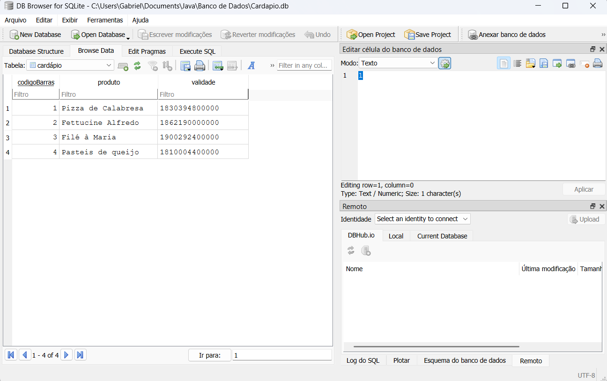
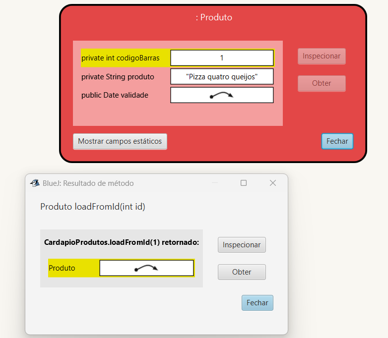
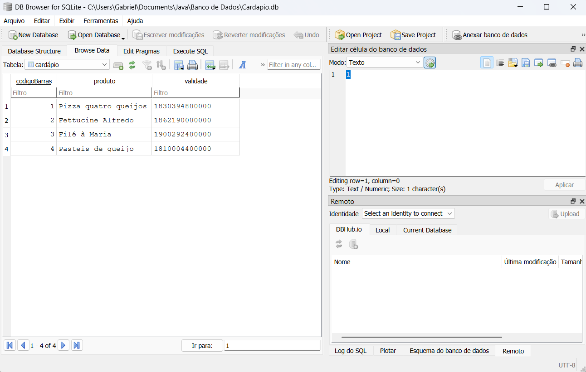
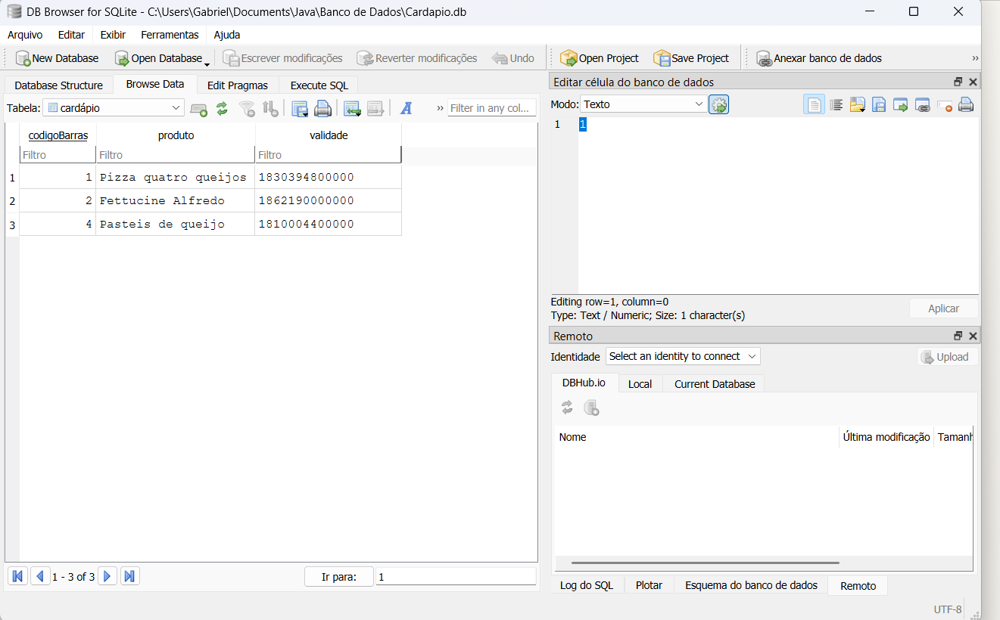

# Atividade Prática – Persistência de Dados com ORM e CRUD

## 1. Introdução

A presente atividade tem como objetivo implementar operações de persistência de dados utilizando o Mapeamento Objeto-Relacional (ORM), por meio da biblioteca ORMLite e do banco de dados relacional SQLite. A implementação foi desenvolvida em Java, seguindo o padrão de projeto Repository, com o intuito de estabelecer uma separação entre a lógica de acesso aos dados e as demais funcionalidades da aplicação.

Para a realização da atividade, foi selecionada a classe `Produto`, pertencente ao projeto de gerenciamento de cardápio. A partir dessa entidade, foram implementadas as operações CRUD (*Create, Read, Update e Delete*), responsáveis por cadastrar, consultar, atualizar e excluir registros do banco de dados.

Além disso, foram desenvolvidas as classes `Database` e `CardapioRepository`, responsáveis, respectivamente, pelo gerenciamento da conexão com o banco de dados e pela execução das operações de persistência.

"[Projeto na IDE do BlueJ](imagens/Projeto.png)

*Figura 1 - Estrutura do projeto na IDE do BlueJ*

## 2. Descrição da implementação

### 2.1. Classe Produto

A classe `Produto` representa a entidade que será persistida no banco de dados. Ela contém os atributos necessários para identificar e descrever um produto do cardápio, sendo eles:

- `codigoBarras`: identificador único do produto, gerado automaticamente pelo banco de dados;
- `produto`: nome ou descrição do produto;
- `validade`: data de validade do produto, representada pelo tipo `Date`.

O mapeamento objeto-relacional foi realizado por meio das anotações disponibilizadas pela biblioteca ORMLite. A anotação `@DatabaseTable` define a tabela correspondente à entidade, enquanto `@DatabaseField` especifica os campos que serão persistidos.

O atributo `codigoBarras` utiliza a propriedade `generatedId = true`, permitindo que o identificador seja gerado automaticamente durante a inserção de um novo registro. Já o atributo `validade` utiliza `DataType.DATE`, indicando que seu valor será armazenado como uma data.

A classe também possui métodos getters e setters, responsáveis pelo acesso e pela modificação dos atributos, além do método `printValidade()`, que realiza a formatação da data no padrão brasileiro `dd/MM/yyyy`.

### 2.2. Classe Database

A classe `Database` é responsável pelo gerenciamento da conexão com o banco de dados SQLite.

Sua implementação utiliza a classe `JdbcConnectionSource`, disponibilizada pela biblioteca ORMLite, para estabelecer a conexão por meio da URL JDBC:

```java
"jdbc:sqlite:" + databaseName
```

O nome do banco de dados é recebido pelo construtor da classe. O método `getConnection()` verifica se o nome foi informado e se uma conexão já foi estabelecida. Caso ainda não exista uma conexão ativa, uma nova conexão é criada.

O método `close()` permite encerrar a conexão com o banco de dados, liberando os recursos utilizados.

Dessa forma, a classe centraliza o gerenciamento da conexão, permitindo que outras classes utilizem o banco de dados sem precisar implementar diretamente os procedimentos de conexão.

### 2.3. Classe CardapioRepository

A classe `CardapioRepository` implementa o padrão Repository, atuando como uma camada intermediária entre a aplicação e o banco de dados.

Essa classe utiliza o objeto `Dao<Produto, Integer>`, fornecido pela biblioteca ORMLite, para executar as operações de persistência. O tipo `Produto` representa a entidade manipulada, enquanto `Integer` corresponde ao tipo do identificador utilizado na consulta.

Durante a inicialização do repositório, o método `setDatabase()` configura o acesso ao banco de dados e utiliza `TableUtils.createTableIfNotExists()` para criar a tabela correspondente à entidade `Produto`, caso ela ainda não exista.

Além do objeto DAO, a classe mantém uma lista denominada `loadedCardapio`, que armazena os produtos carregados durante a execução da aplicação, e uma referência `loadedProduto`, utilizada para representar o produto atualmente carregado.

A implementação das operações CRUD é descrita a seguir.

## 3. Implementação das operações CRUD

### 3.1. Create – Cadastro de produtos

A operação Create é implementada pelo método `create(Produto produto)`.

Esse método recebe um objeto da classe `Produto` e utiliza o método `dao.create()` para inserir seus dados no banco de dados.

Após a inserção bem-sucedida, o objeto é armazenado na lista `loadedCardapio` e definido como o produto atualmente carregado por meio do atributo `loadedProduto`.

O retorno do método corresponde ao próprio objeto cadastrado.

A implementação também verifica se a operação retornou zero linhas afetadas. Caso isso ocorra, uma exceção é lançada, indicando que o objeto não foi salvo.

Dessa maneira, a operação permite cadastrar novos produtos no cardápio e garantir sua persistência no banco de dados.

**Evidência da operação Create:**



*Figura 2 – Cadastro de um novo produto no banco de dados.*

### 3.2. Read – Consulta de produtos

A operação Read é implementada por meio de dois métodos: `loadFromId(int id)` e `loadAll()`.

O método `loadFromId(int id)` realiza uma consulta utilizando o identificador do produto. Para isso, utiliza o método `dao.queryForId()`, que retorna o objeto correspondente ao identificador informado.

Caso o produto seja encontrado, ele é armazenado na lista `loadedCardapio` e definido como o produto atualmente carregado.

Já o método `loadAll()` utiliza `dao.queryForAll()` para recuperar todos os registros existentes na tabela correspondente à entidade `Produto`.

Os resultados são armazenados na lista `loadedCardapio`, permitindo que os produtos sejam posteriormente acessados pela aplicação.

A implementação, portanto, permite realizar consultas tanto individuais quanto gerais, atendendo aos requisitos da operação Read.

**Evidência da operação Read:**



*Figura 3 – Consulta dos produtos armazenados no banco de dados.*

### 3.3. Update – Atualização de produtos

A operação Update é implementada pelo método `update(Produto produto)`.

Esse método recebe um objeto previamente cadastrado e utiliza `dao.update()` para atualizar seus dados no banco de dados.

Após a execução da operação, o método verifica se houve alteração de algum registro. Caso a atualização seja bem-sucedida, o objeto é definido como o produto atualmente carregado.

Além disso, o método utiliza `loadedCardapio.indexOf(produto)` para verificar se o objeto está presente na lista de produtos carregados. Caso esteja, sua posição na lista é atualizada com os novos dados.

Essa implementação permite modificar as informações de um produto existente, mantendo a persistência das alterações no banco de dados.

**Evidência da operação Update:**



*Figura 4 – Atualização das informações de um produto cadastrado.*

### 3.4. Delete – Exclusão de produtos

A operação Delete é implementada pelo método `delete(Produto produto)`.

Esse método recebe um objeto da classe `Produto` e utiliza `dao.delete()` para remover o registro correspondente do banco de dados.

Após a exclusão bem-sucedida, o método verifica se o produto removido corresponde ao objeto atualmente carregado. Caso corresponda, a referência `loadedProduto` é definida como `null`.

O produto também é removido da lista `loadedCardapio`, caso esteja presente.

Dessa forma, a operação permite excluir produtos do banco de dados e atualizar as estruturas de dados mantidas pelo repositório.

**Evidência da operação Delete:**



*Figura 5 – Exclusão de um produto do banco de dados.*

## 4. Persistência dos dados

A persistência dos dados é realizada por meio da integração entre Java, ORMLite e SQLite.

O ORMLite é responsável pelo mapeamento dos objetos Java para os registros da tabela relacional, permitindo que as operações de manipulação dos dados sejam realizadas por meio de métodos específicos da biblioteca.

A conexão com o banco de dados é estabelecida pela classe `Database`, enquanto a classe `CardapioRepository` utiliza o objeto DAO para executar as operações de inserção, consulta, atualização e exclusão.

Como o banco de dados SQLite é armazenado em um arquivo, os dados permanecem disponíveis após o encerramento da aplicação, desde que o mesmo arquivo seja utilizado nas próximas execuções.

A lista `loadedCardapio` possui a finalidade de manter os produtos carregados durante a execução da aplicação. Entretanto, ela não representa o mecanismo de persistência propriamente dito, uma vez que os dados são armazenados efetivamente no banco de dados.

Para comprovar a persistência, foram realizados testes de inserção e consulta dos registros, verificando-se que os produtos cadastrados permanecem disponíveis mesmo após o encerramento e a reinicialização da aplicação.

**Evidência da persistência dos dados:**


*Figura 6 – Verificação da persistência dos dados no SQLite.*

## 5. Testes realizados

Para verificar o funcionamento da implementação, foram realizados testes envolvendo as quatro operações CRUD.

Os testes tiveram como finalidade verificar:

1. A inserção de novos produtos no banco de dados;
2. A consulta de produtos pelo identificador e a listagem de todos os registros;
3. A atualização das informações de um produto previamente cadastrado;
4. A exclusão de um produto existente;
5. A persistência dos registros após o encerramento e a reinicialização da aplicação.

Os resultados obtidos permitiram verificar o funcionamento das operações de manipulação dos dados, bem como a integração entre as classes desenvolvidas e o banco de dados SQLite.

## 6. Conclusão

A implementação realizada permitiu aplicar os conceitos de Mapeamento Objeto-Relacional (ORM) e persistência de dados em uma aplicação Java, utilizando a biblioteca ORMLite e o banco de dados SQLite.

A utilização da classe `Produto` como entidade possibilitou o mapeamento dos atributos Java para os campos de uma tabela relacional, enquanto a classe `Database` centralizou o gerenciamento da conexão com o banco de dados.

Por sua vez, a implementação da classe `CardapioRepository` permitiu organizar as operações de persistência de acordo com o padrão Repository, separando o acesso aos dados das demais funcionalidades da aplicação.

As operações CRUD foram implementadas por meio dos métodos disponibilizados pelo ORMLite, possibilitando o cadastro, a consulta, a atualização e a exclusão de produtos.

Conclui-se que a atividade contribuiu para a compreensão dos mecanismos de persistência de dados e da utilização de ORM em aplicações Java, demonstrando como a integração entre objetos e bancos de dados relacionais pode ser realizada de maneira organizada e eficiente.
